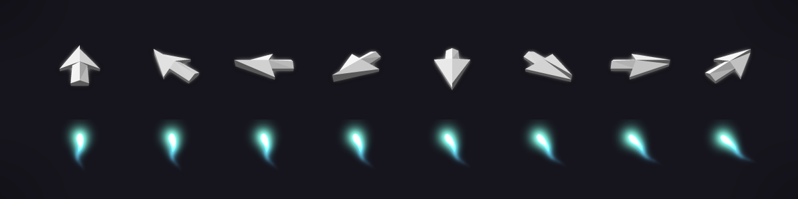
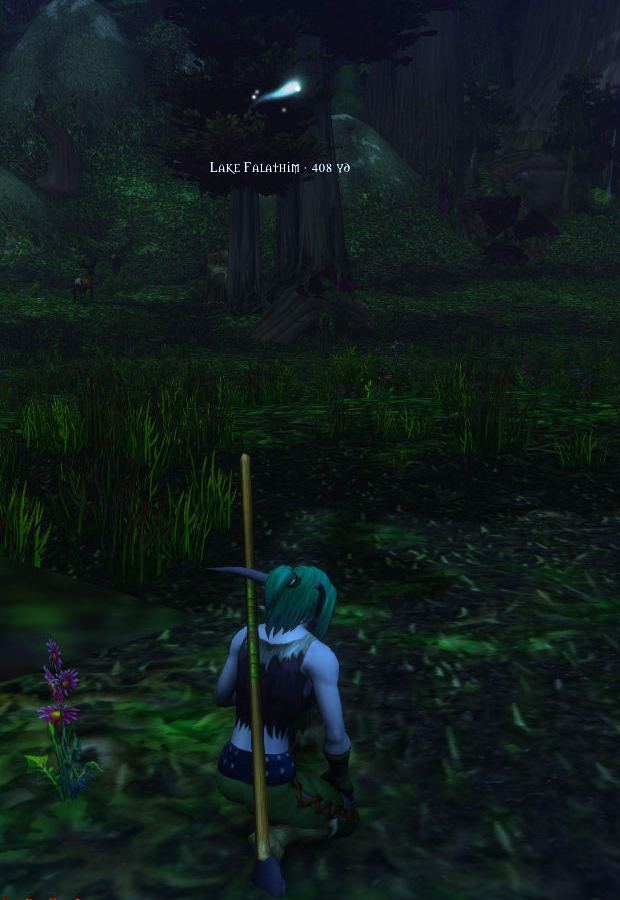

# Wayfinder





### Stop opening the map: a see-through arrow walks you round your route, one waypoint after another.

## What you get

- **You never lose the next spot.** An arrow on your screen points to the next waypoint and counts down the yards,
  and says Arrived when you're within 6 yards. It works across zones on the same continent, and on another continent it tells you
  which zone to travel to.
- **It stays out of the way.** The arrow is half see-through until you point at it, takes your class colour with a
  thin dark rim, and hides itself in arenas and battlegrounds. Drag it anywhere.
- **Night elves follow a wisp.** A glowing wisp with motes circling it leads the way instead of the arrow;
  `/wf wisp` switches between the two for any race.
- **The game's own marker too.** Each step sets Blizzard's map pin, so the in-world marker shows where you're going.
- **Gathering loops that move on by themselves.** On a gather run, passing within 30 yards of the current spot, or
  any of the next 12, moves you on, and the end loops back to the start.
- **Trainer runs that keep up with you.** Talk to the trainer near a step and Wayfinder saves where they really
  stand; close their window and it moves on to the next step.
- **Your own routes.** `/wf way <x> <y> [title]` adds a waypoint on the map you're on to your own "My waypoints"
  run. A step in the wrong place? Stand on the right spot and type `/wf here`, or drop a map pin for a step that has
  no coordinates yet. Fixes and progress are saved, and each character keeps its own run.
- **One click to switch.** Click the run name, or right-click the compass-star minimap button, for a list of your
  runs with how far along each one is, and to start one over.
- **A worker with opinions.** Click the arrow and your race's worker answers: the peon for orcs, the peasant for
  humans, your own race's voice for the rest. Click too often and they file a grievance with your leader.
  `/wf voice` changes the voice, `/wf sound` turns it off.
- **Errands while you queue.** Click the catch-up line for a run of the errands waiting for you, starting with the
  mailbox. In a dungeon or PvP queue it keeps to the ones in this city that fit before the pop, and it learns how
  long your queues really take.

The runs that come with this release are for a night elf called Chalice on WoW Forever: Cooking to 100, a
Teldrassil herb loop, a Teldrassil mining loop, and the Auberdine loop (60 herb and copper spots out of Auberdine
through Darkshore and back to the mailbox). A run names its character, so it only shows on that character; on any
other character you build your own with `/wf way`.

## Why

The game gives you one map pin at a time and a minimap that only shows what's close. Walking a gathering loop of 60
spots, or a string of trainers across a zone, means opening the map again at every node, finding the next spot,
pinning it, and closing it. Wayfinder holds the whole route and keeps one thing on screen: which way to turn and
how far it is.

## Download

1. Download `Wayfinder-vX.Y.Z.zip` from the [latest release](https://github.com/rainbowpusheenthe3rd/wayfinder/releases/latest).
2. Unzip the `Wayfinder` folder into `World of Warcraft\_forever_\Interface\AddOns`.
3. Log in. The arrow appears near the top of the screen; click the minimap button to show or hide it.

Commands: `/wf next`, `/wf back`, `/wf list` (the run's steps), `/wf run` (next run), `/wf here` (this step is where
I stand), `/wf way <x> <y> [title]`, `/wf restart` (start the run over and clear its fixes), `/wf wisp`,
`/wf voice`, `/wf sound`, `/wf hide | show`.

<details>
<summary>Art and development</summary>

The arrow is a 3D arrow on the ground, pre-rendered at 64 angles with its rim by `tools/wayfinder_textures.py`; the
wisp and its motes come from `tools/wisp_textures.py` with the same camera. The worker voices are the game's own
sound files, listed by `tools/wayfinder_voices.py` from wowdev's community listfile into `Voices.lua`.

Runs are kept as `runs/*.json` and written into `Route.lua`; a new run needs only a `/reload`. The Auberdine loop
is built by `tools/auberdine_loop.py`: nearest neighbour makes a loop from the mailbox, then 2-opt uncrosses it
until no swap helps. [`docs/auberdine_pathing.html`](docs/auberdine_pathing.html) plays that back step by step;
download it and open it in a browser.

The catch-up line's gold, concentration and crafting steps come from the ProfessionLedger and ProfessionQueue
addons when they are loaded; without them it covers the mailbox and your queues.

For development, link the game's folder to this repo (a directory junction, run once):

```powershell
New-Item -ItemType Junction -Path "<WoW folder>\_forever_\Interface\AddOns\Wayfinder" -Target "<this repo>"
```

</details>

<p align="center"></p>
